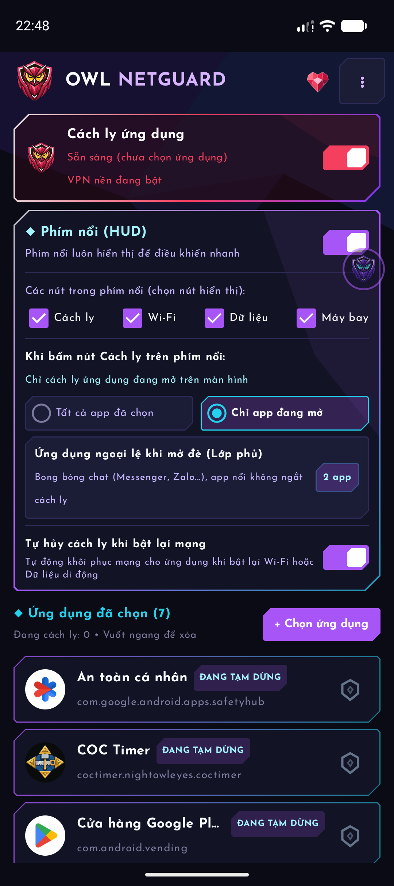
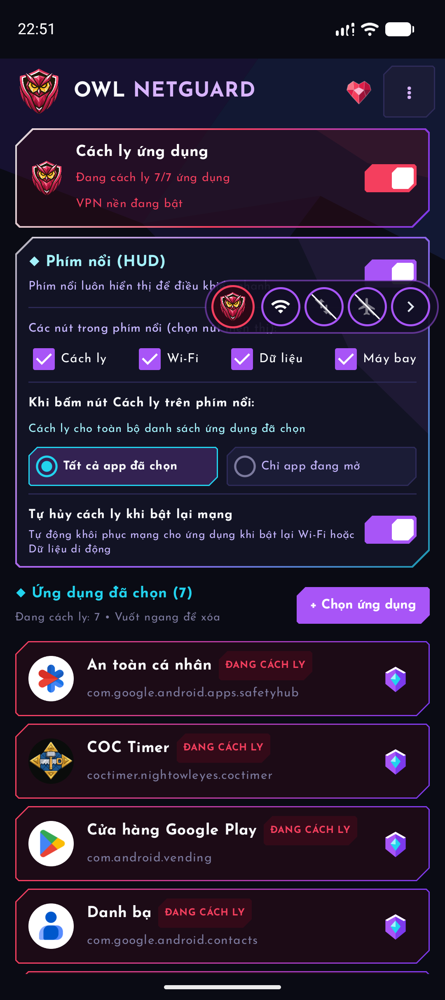
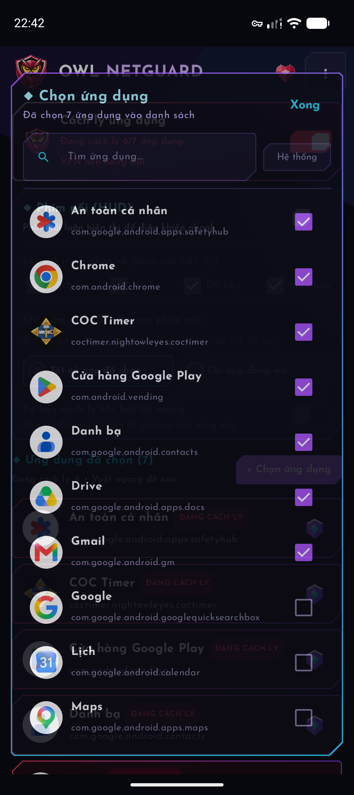
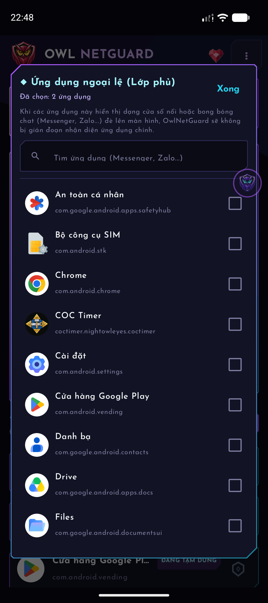
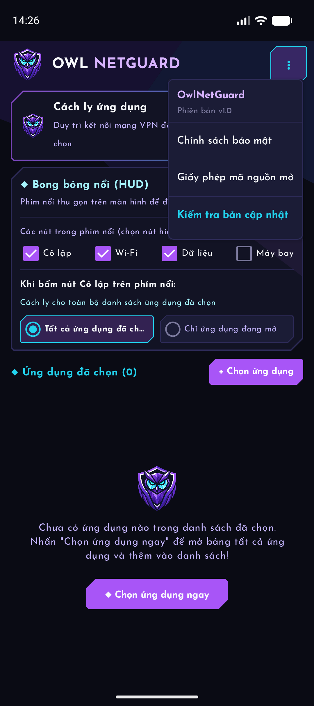

# OwlNetGuard 🦉🛡️

<p align="center">
  
</p>

<p align="center">
  <strong>Công cụ cô lập mạng & tường lửa Sinkhole thông minh cho Android</strong>
</p>

<p align="center">
  <a href="https://github.com/NightOwlEyes/OwlNetGuard/releases/latest">
    
  </a>
  <a href="https://github.com/NightOwlEyes/OwlNetGuard/releases/latest">
    
  </a>
  
  
  <a href="https://www.virustotal.com/gui/file/1a3c07b2bfe41cff5960704d9e199a2c0a1192a7348639f5d35de2aaa4a5b229">
    
  </a>
  <a href="LICENSE">
    
  </a>
</p>

<p align="center">
  <a href="https://github.com/NightOwlEyes/OwlNetGuard/releases/latest">
    
  </a>
</p>

---

## 📖 Giới thiệu

**OwlNetGuard** là ứng dụng Android mã nguồn mở được thiết kế để kiểm soát và cô lập kết nối Internet của từng ứng dụng riêng biệt một cách an toàn, nhanh chóng và mượt mà. 

Ứng dụng sử dụng cơ chế **Local VPN Sinkhole** chuẩn của Android để hấp thụ toàn bộ gói tin của các ứng dụng bị chặn ngay trên thiết bị mà **không cần quyền Root**, **không chuyển hướng dữ liệu qua bất kỳ máy chủ trung gian nào** và **Vượt kiểm duyệt của Google Play Protect**.

---

## ✨ Tính năng nổi bật

* 🛡️ **Lõi VPN Sinkhole cục bộ**: 100% lưu lượng mạng được xử lý trực tiếp trên thiết bị, bảo đảm quyền riêng tư tuyệt đối, không gửi dữ liệu ra ngoài và không hao pin.
* 🔮 **Bong bóng nổi thông minh (HUD Quick Ball)**:
  * Phím nổi thu gọn tiện dụng trên màn hình, hỗ trợ điều khiển nhanh: Cách ly, Wi-Fi, Dữ liệu di động, Chế độ máy bay.
  * **Cơ chế nhấn 2 lần để hủy cách ly**: Khi app đang cách ly, chạm lần 1 sẽ hiện thông báo *"Nhấn thêm lần nữa để tạm dừng cách ly"*, chạm lần 2 trong vòng 2.5s mới xác nhận mở mạng.
  * **Chỉ báo trạng thái trực quan**: Biểu tượng Cú tự động đổi màu **Đỏ thẫm phát sáng** khi ứng dụng đang mở bị cách ly và màu **Tím** khi bình thường. Biểu tượng Wi-Fi / Dữ liệu tự động gạch chéo mờ khi ngắt mạng.
  * Nhấn giữ để tắt HUD nhanh chóng.
* 🔄 **Tự động hủy cách ly khi bật lại mạng**:
  * Khi toàn bộ kết nối mạng (cả Wi-Fi lẫn Dữ liệu di động) bị ngắt rồi được bật trở lại, hệ thống tự động giải phóng cách ly cho ứng dụng.
* 🎯 **Hai chế độ cô lập mạng linh hoạt**:
  * **Tất cả ứng dụng đã chọn**: Tạm ngưng hoặc kích hoạt chặn mạng hàng loạt cho toàn bộ danh sách chỉ với 1 chạm.
  * **Chỉ ứng dụng đang mở (Foreground Mode)**:
    * Khi chưa mở app trong danh sách: Tạm ngưng hoặc kích hoạt chặn mạng cho ứng dụng đang mở trên màn hình chỉ với 1 chạm.
    * Hỗ trợ **Danh sách ứng dụng ngoại lệ (Lớp phủ)**: Khi có Bảng Wi-Fi, bàn phím, hay bong bóng chat (Messenger, Zalo...) hiển thị đè lên app đang cách ly sẽ không làm ngắt phiên cách ly của app bên dưới.
---

## 📸 Ảnh chụp màn hình ứng dụng

| Bảng điều khiển chính (Faceted & HUD) | Phím nổi HUD mở rộng điều khiển | Bảng chọn ứng dụng (App Picker) |
| :---: | :---: | :---: |
|  |  |  |

| Ứng dụng ngoại lệ khi mở đè (Lớp phủ) | Menu phiên bản & Cài đặt |
| :---: | :---: |
|  |  |

---

## 🚀 Tải về & Cài đặt

1. Truy cập trang phát hành: [GitHub Releases - OwlNetGuard](https://github.com/NightOwlEyes/OwlNetGuard/releases/latest)
2. Tải file **`app-release.apk`**.
3. Cài đặt trực tiếp trên thiết bị Android của bạn (hỗ trợ từ Android 8.0 Oreo đến Android 15/16).
4. Mở ứng dụng, chọn các app bạn muốn cách ly mạng và bật **Cách ly ứng dụng**!

---

## 🔒 Minh bạch quyền truy cập (Permissions)

OwlNetGuard tuyệt đối không yêu cầu các quyền nhạy cảm nguy hiểm:

* `android.permission.INTERNET`: Duy trì dịch vụ giao diện mạng.
* `android.net.VpnService`: Thiết lập đường hầm Sinkhole cục bộ trên máy để ngăn chặn kết nối cho các app được chọn.
* `android.permission.SYSTEM_ALERT_WINDOW`: Hiển thị phím nổi thông minh trên màn hình.
* `android.permission.PACKAGE_USAGE_STATS` *(tùy chọn)*: Chỉ yêu cầu khi bạn bật chế độ *"Chỉ ứng dụng đang mở"* để phát hiện gói ứng dụng Foreground hiện thời.

---

## 📁 Cấu trúc thư mục (File Structure)

> Chi tiết giải thích kiến trúc và luồng xử lý của từng tệp mã nguồn xem tại: [FILE_STRUCTURE.md](FILE_STRUCTURE.md)

---

## 🛠️ Hướng dẫn tự build từ mã nguồn

### Yêu cầu:
* JDK 17 hoặc JDK 21
* Android SDK (API Level 36)

### Lệnh build:

```powershell
# Clone mã nguồn
git clone https://github.com/NightOwlEyes/OwlNetGuard.git
cd OwlNetGuard

# Build bản Debug để trải nghiệm
.\gradlew.bat assembleDebug

# Build bản Release (yêu cầu cấu hình .secret/key.properties)
.\gradlew.bat assembleRelease
```

File APK sẽ nằm tại:
`app/build/outputs/apk/release/app-release.apk`

---

## 🛡️ Kiểm định an toàn & VirusTotal

OwlNetGuard hoàn toàn sạch mã độc, đạt chuẩn an toàn 100%:
* 🟢 **Báo cáo VirusTotal**: [0/68 Nhà cung cấp bảo mật phát hiện - Clean 100%](https://www.virustotal.com/gui/file/1a3c07b2bfe41cff5960704d9e199a2c0a1192a7348639f5d35de2aaa4a5b229)
* 🟢 **Google Play Protect**: Tuân thủ 100% tiêu chuẩn bảo mật của Android, hoạt động hoàn toàn offline không thu thập dữ liệu người dùng.

---

## 📄 Bản quyền & Giấy phép

Phát triển bởi **NightOwlEyes**.
Phát hành theo giấy phép mã nguồn mở [GNU General Public License v3.0 (GPL-3.0)](LICENSE).
Logo và đồ họa biểu tượng thuộc bản quyền của dự án OwlNetGuard.
